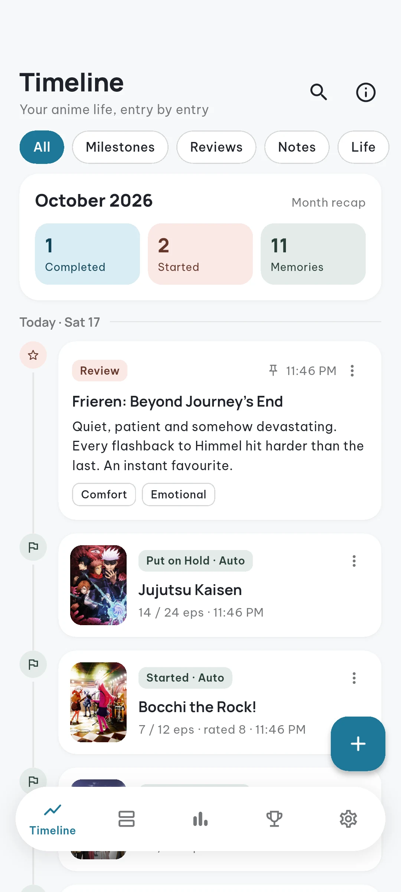
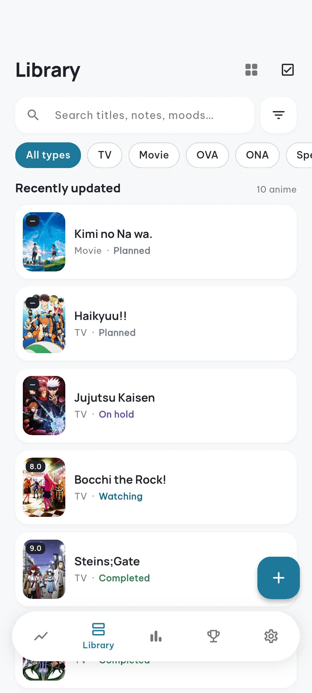
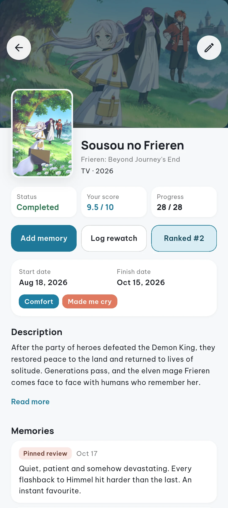
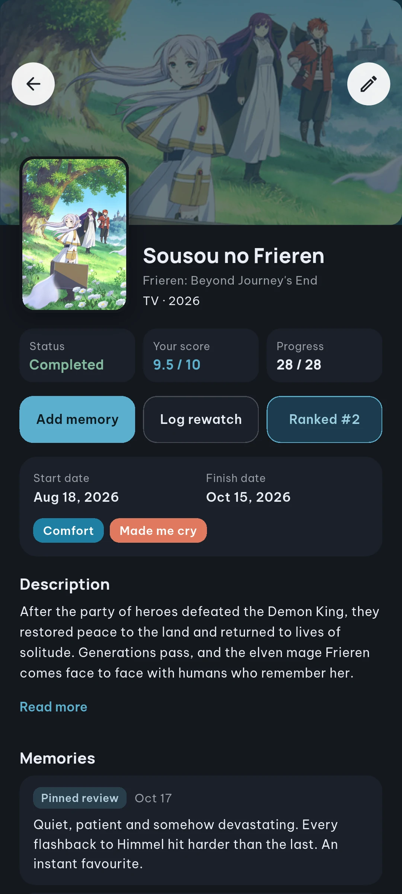
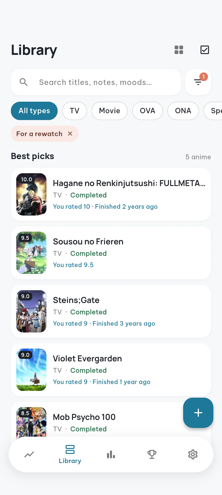
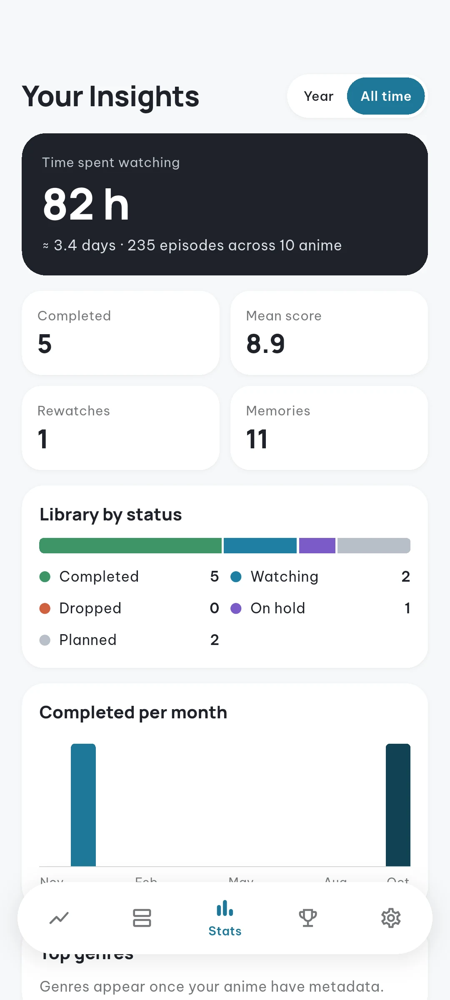
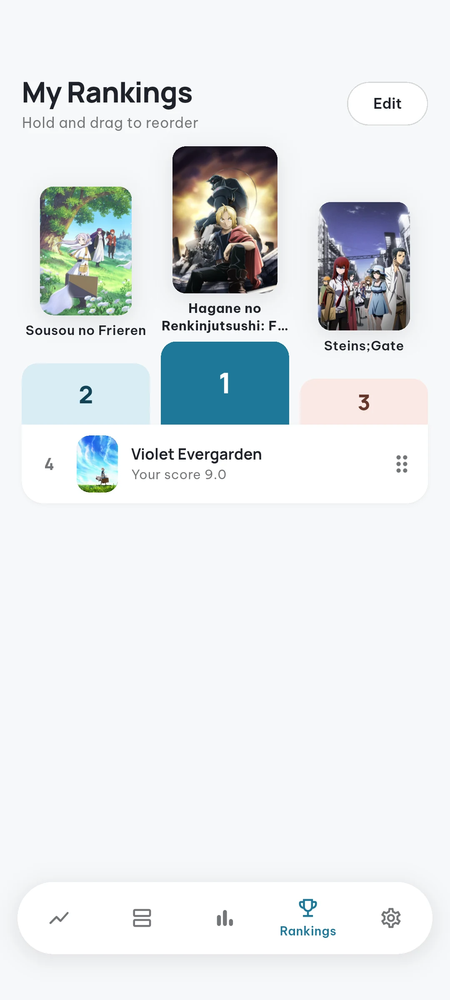
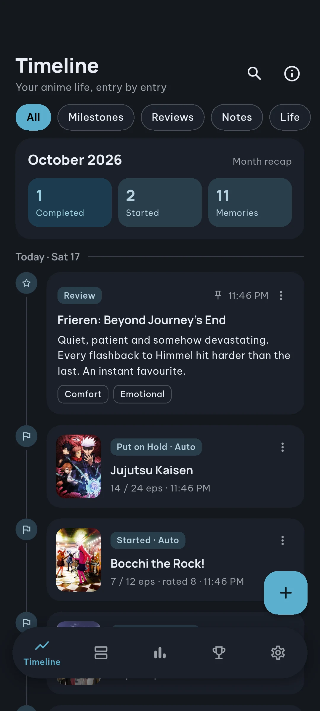
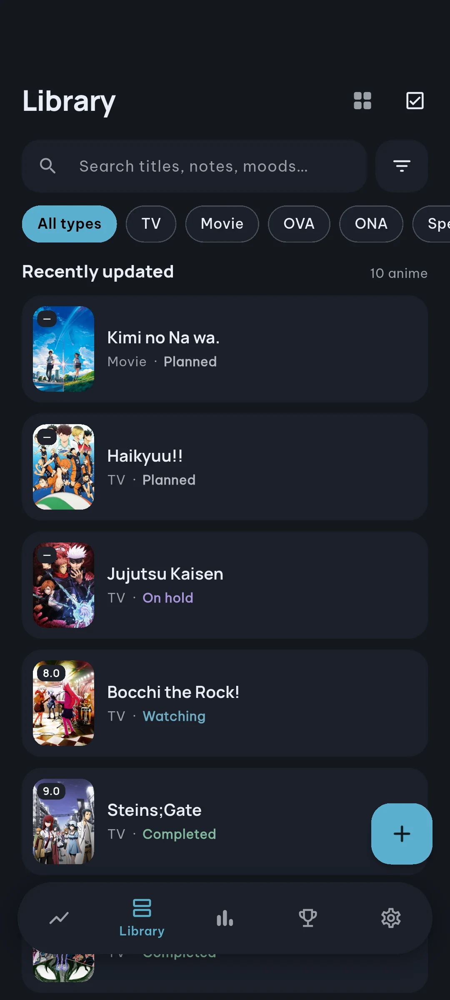
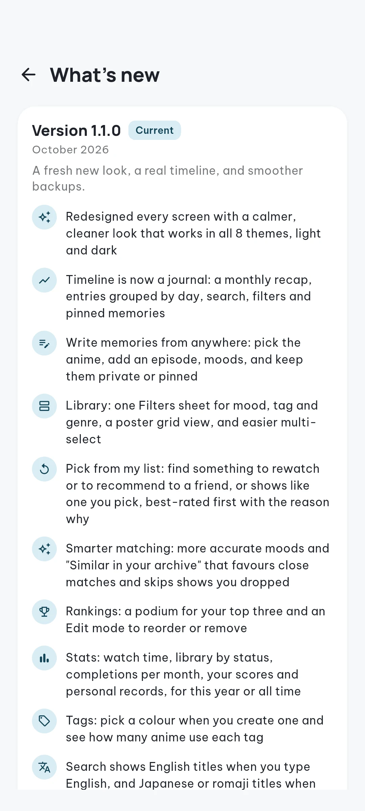

# AniLog

**Your personal anime journal.** Track what you watch, remember how it made you feel,
and always know what to watch (or recommend) next.

**[🌐 Website](https://anilogapp.vercel.app)** · **[⬇️ Download for Android](../../releases/latest)** · [Web version](https://anilog-app.vercel.app) · [What's new](CHANGELOG.md) · Made by [Devesh Tatkare](https://deveshtatkare.com)

 

> [!IMPORTANT]
> **AniLog is free to use, but it is not open source.**
> You're welcome to download and use the app. The source code is private, and copying,
> modifying, re-uploading or redistributing any part of AniLog is not allowed.
> See [LICENSE](LICENSE).

---

## Why AniLog?

Most trackers are lists of numbers. AniLog is a **journal**: every anime you add,
finish, rate or rewatch becomes a moment on your personal timeline, next to the
notes and memories you write yourself.

- **Private by default.** On your phone everything stays on your device. No account needed.
- **Starts empty.** No sample data, no clutter. Your library is only what you add.
- **Works offline.** Search, filters, stats and rankings all run on your device.

---

## Features

<table>
<tr>
<td width="50%" valign="top">

### 📖 Timeline
Your anime life, entry by entry. A monthly recap at the top, entries grouped by day,
and automatic milestones when you start, finish or pause a show.
Write reviews, quick notes or real-life memories ("movie night with my sister")
and pin the ones you love.

</td>
<td width="50%" align="center">

</td>
</tr>

<tr>
<td width="50%" align="center">

</td>
<td width="50%" valign="top">

### 📚 Library
Everything you've watched, are watching or plan to watch. Search titles, notes and
moods, filter by type, mood, tag or genre, and switch between a list and a poster grid.
Select several at once to update or remove them together.

</td>
</tr>

<tr>
<td width="50%" valign="top">

### 🎯 Pick from my list
Not sure what to watch? Ask your own library.

- **For a rewatch:** your best-rated finished shows, favouring ones you haven't seen in a while
- **To recommend:** the safest picks to share with a friend
- **Like this one:** shows from your list closest to one you choose

Every pick tells you *why*: "You rated 10 · Finished 2 years ago".

</td>
<td width="50%" align="center">

</td>
</tr>

<tr>
<td width="50%" align="center">

</td>
<td width="50%" valign="top">

### 🎬 Every anime, in detail
Your status, score and progress at a glance. Start and finish dates, your own tags,
the memories you've written, rewatch history, and its place in your rankings.
Adding a new anime takes a couple of taps: search, pick, done.

</td>
</tr>

<tr>
<td width="50%" valign="top">

### 📊 Insights
How many hours you've really spent watching, your library by status, completions
per month, your average score and personal records, for this year or all time.

</td>
<td width="50%" align="center">

</td>
</tr>

<tr>
<td width="50%" align="center">

</td>
<td width="50%" valign="top">

### 🏆 Rankings
Your all-time favourites on a podium. Hold and drag to reorder, or use Edit mode
to rearrange and remove.

</td>
</tr>
</table>

### And more

| | |
|---|---|
| 🎨 **8 themes** | Light, dark and six more presets, all with readable contrast |
| 🏷️ **Custom tags** | Colour-coded tags like "Comfort" or "Made me cry", with usage counts |
| 🔁 **Rewatches** | Log every rewatch with dates and notes |
| 💾 **Backups** | Export your whole archive to a single file and restore it anytime, with a step-by-step review if anything conflicts |
| 🌐 **Web version** | Sign in to keep your library in sync in the browser |
| 📱 **Any screen** | Phones, tablets and desktop, with a side navigation rail on larger screens |

---

## Dark mode

---

## Get AniLog

| Platform | How |
|---|---|
| 🌐 **Website** | **[anilogapp.vercel.app](https://anilogapp.vercel.app)**: overview, screenshots and downloads |
| 💻 **Web version** | Use the app in any modern browser: **[anilog-app.vercel.app](https://anilog-app.vercel.app)** |
| 🤖 **Android** | Download the APK from the [latest release](../../releases/latest) (pick **arm64** for most phones) |
| 🍎 **iOS · Desktop** | Coming later |

See what changed in each version in the [changelog](CHANGELOG.md), or in the app under
**Settings → What's new**.

---

## Author

AniLog is designed and built by **[Devesh Tatkare](https://deveshtatkare.com)**.

## About this repository

This repository hosts the official AniLog downloads, screenshots and changelog.
The `showcase/` folder contains a small excerpt of the app's design system, shown
for viewing only. It is not a working app, and the full source code is private.

## License

© 2026 Devesh Tatkare. All rights reserved.

- ✅ Free to download and use the app for personal use
- ❌ No copying or reusing the code, design or graphics
- ❌ No modified versions, re-uploads or redistribution of the app or APKs
- ❌ No publishing it under another name or account

Full terms in [LICENSE](LICENSE). For permission requests, contact
[deveshtatkare.com](https://deveshtatkare.com).
